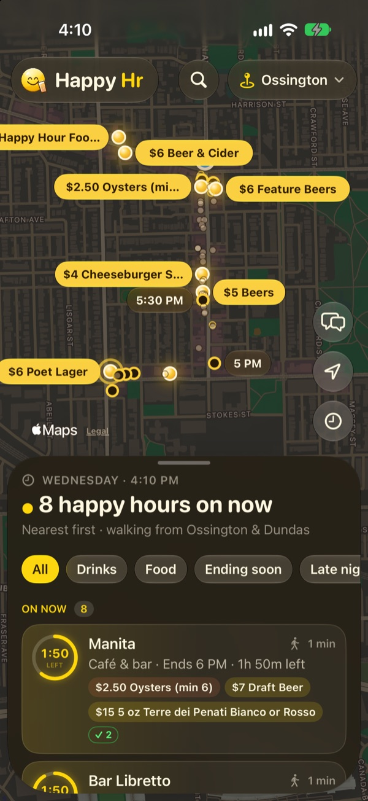
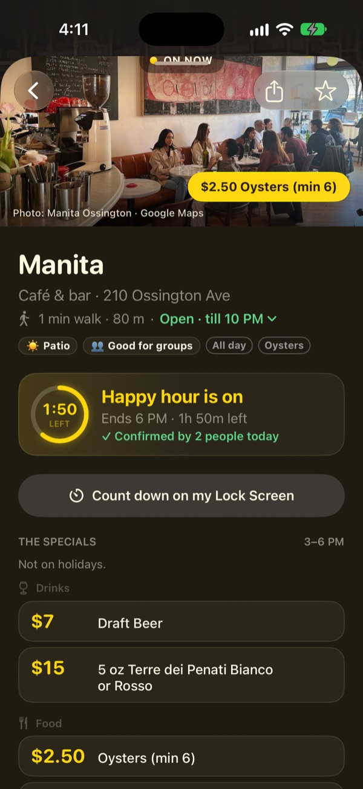
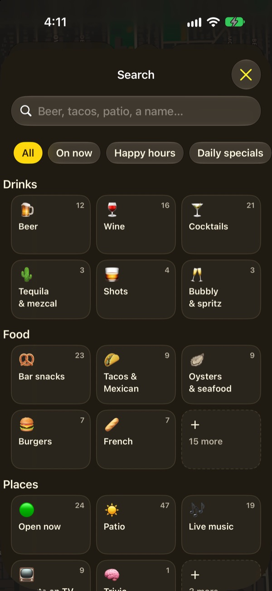
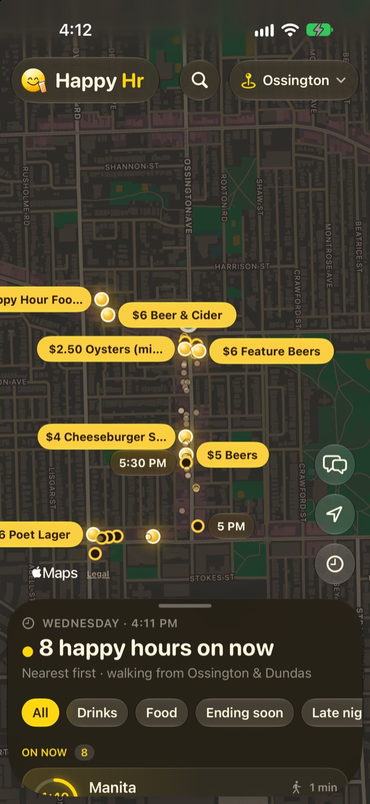
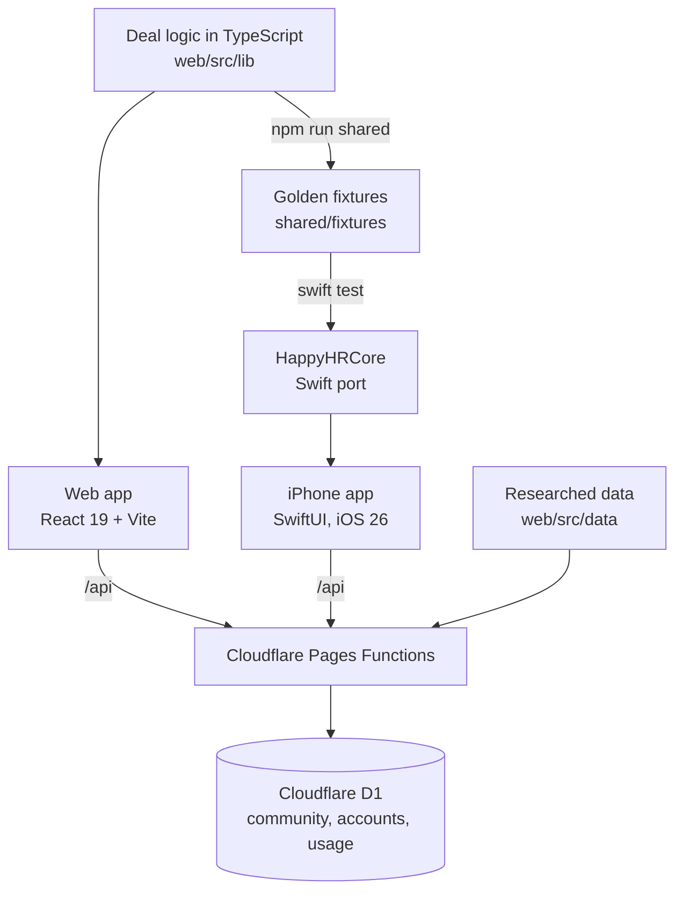

# Happy Hr

**Happy hours and daily specials near you, and how long each one has left.**

Happy Hr is a web app and a native iPhone app for finding the deals that are on right now in Toronto's Ossington, Kensington, King West and Liberty Village, and in Guelph and Burlington. Each deal was researched from the venue's own menu or site, and each one says where it came from.

- **Web (live beta):** https://happy-hr-beta.pages.dev
- **iPhone:** SwiftUI app for iOS 26, in a TestFlight beta

<p align="center">
  
  
  
  
</p>

## What it does

- **What's on now, nearest first.** A map of deal pins and a sheet of cards, each with a ring counting down to the end of its happy hour. Cards show the walking time from where you are.
- **Happy hours and daily specials are kept apart.** Time-boxed happy hours get the countdown. Day-of-the-week deals like "Taco Tuesday" show as a quiet "Today" tag, so they never crowd out what's ending soon.
- **Search that forgives.** It handles accents, apostrophes, typos and half-typed words, and maps "beer", "patio" or "live music" to the right filters. It won't correct a word the app already knows, so "wings" never turns into "wines". Results can be sorted by the cheapest deal.
- **Venue pages.** Opening hours ("Open · till 10 PM"), the specials, the week at a glance, and tags like Patio or Good for groups. You can share a spot or a plan ("Meet at 5:30?") as a link.
- **Community checks.** People confirm that a deal is still on ("✓ Confirmed by 2 people today") or add one. Deals that haven't been checked in 120 days get a "May be out of date" tag. Venue owners can claim their spot and post as the venue.
- **iPhone extras.** Liquid Glass design, Apple Maps, home and Lock Screen widgets, a Live Activity that counts down to a happy hour, alerts for starred spots, Sign in with Apple and a moderated group chat.

## By the numbers

| | |
| --- | --- |
| Areas | 6 (4 Toronto neighbourhoods, Guelph, Burlington into Oakville) |
| Spots | 458 places that serve alcohol, 186 of them with researched deals |
| Deals | 250 happy hours and 398 daily specials, each with a cited source |
| Tests | 141 web tests and 49 Swift tests; the Swift ones replay the web's answers |

## How it's built



Some of the decisions behind it:

- **One set of rules, two languages.** The deal logic lives in TypeScript ([`web/src/lib`](web/src/lib)): time, ranking, search, opening hours, freshness and more. A script runs it over known cases and writes the answers to [`shared/fixtures`](shared/fixtures). The Swift port ([`ios/HappyHRCore`](ios/HappyHRCore)) is tested against those same files, so both apps agree.
- **Time is always Toronto time.** That holds whatever time zone the phone is set to. A happy hour can run past midnight (times above 1440 minutes spill into the next day), and a place open until midnight joins up with the next day's hours ([`time.ts`](web/src/lib/time.ts), [`hours.ts`](web/src/lib/hours.ts)).
- **Data changes don't need an app release.** The API serves every area's spots with a content-hash ETag. The iPhone app fetches them each time it opens, keeps an offline copy and ships a built-in one to fall back on. Adding an area or fixing a deal is a web deploy.
- **The API is small and careful.** It runs as Cloudflare Pages Functions over D1 (SQLite), and the contract is written down in [`shared/api/openapi.yaml`](shared/api/openapi.yaml). Check-ins, submissions, sign-in codes and chat all have rate limits. Sign-in codes, session tokens and venue keys are stored hashed. A new feature degrades gracefully until its database migration has run.
- **Usage counts that don't track people.** Location is rounded before it leaves the device, to the centre of a square about 550 m across (5.5 km away from our areas), and the server refuses anything that isn't such a centre. Only daily totals are kept, and phones are counted by a salted hash that's dropped after 90 days ([`usage.ts`](web/src/lib/usage.ts)).
- **Research with provenance.** Each deal is marked as coming from the venue, from a third-party guide (shown as unconfirmed) or from the community. The method is written up in [`RESEARCH.md`](web/src/data/areas/RESEARCH.md), and each area keeps its own research notes.

## Tech

| | |
| --- | --- |
| Web | React 19, TypeScript, Vite 8, Google Maps (falls back to MapLibre and OpenStreetMap), Vitest |
| API | Cloudflare Pages Functions, D1 (SQLite), OpenAPI 3.1 |
| iPhone | SwiftUI, iOS 26 Liquid Glass, MapKit, WidgetKit, ActivityKit, Swift Charts, Sign in with Apple, XcodeGen |
| Data | Google Places for the list of candidate spots; deals researched by hand from venue menus and sites |

## What's where

| Folder | What |
| --- | --- |
| [`web/`](web) | The web app and the API it's hosted with: [`functions/api`](web/functions/api) holds the endpoints and [`migrations`](web/migrations) the database schema. See [web/README.md](web/README.md). |
| [`web/src/lib/`](web/src/lib) | The deal logic both apps share. Pure TypeScript, no React. |
| [`web/src/data/areas/`](web/src/data/areas) | Every area: its outline, candidate spots, research and the built list of venues. |
| [`ios/`](ios) | The iPhone app ([`HappyHR`](ios/HappyHR)), its widgets ([`HappyHRWidgets`](ios/HappyHRWidgets)) and the Swift core ([`HappyHRCore`](ios/HappyHRCore)). See [ios/README.md](ios/README.md). |
| [`shared/`](shared) | The API contract, the golden fixtures and the design tokens both apps use. |
| [`reports/`](reports), [`research_notes/`](research_notes) | The deal research behind the data. |

## Run it

The web app needs Node 20.19 or later:

```bash
cd web
npm install
npm run dev     # http://localhost:5173
npm test        # logic tests, plus a check that the shared fixtures are current
```

No keys are needed. Without a Google Maps key the map uses OpenStreetMap, and without the API the community features stay hidden. `web/.env.example` lists the optional settings.

For the iPhone app, you need Xcode with the iOS 26 SDK and [XcodeGen](https://github.com/yonaskolb/XcodeGen):

```bash
cd ios
xcodegen                         # generates HappyHR.xcodeproj
open HappyHR.xcodeproj           # pick your signing team, then run
cd HappyHRCore && swift test     # the Swift core against the shared fixtures
```
